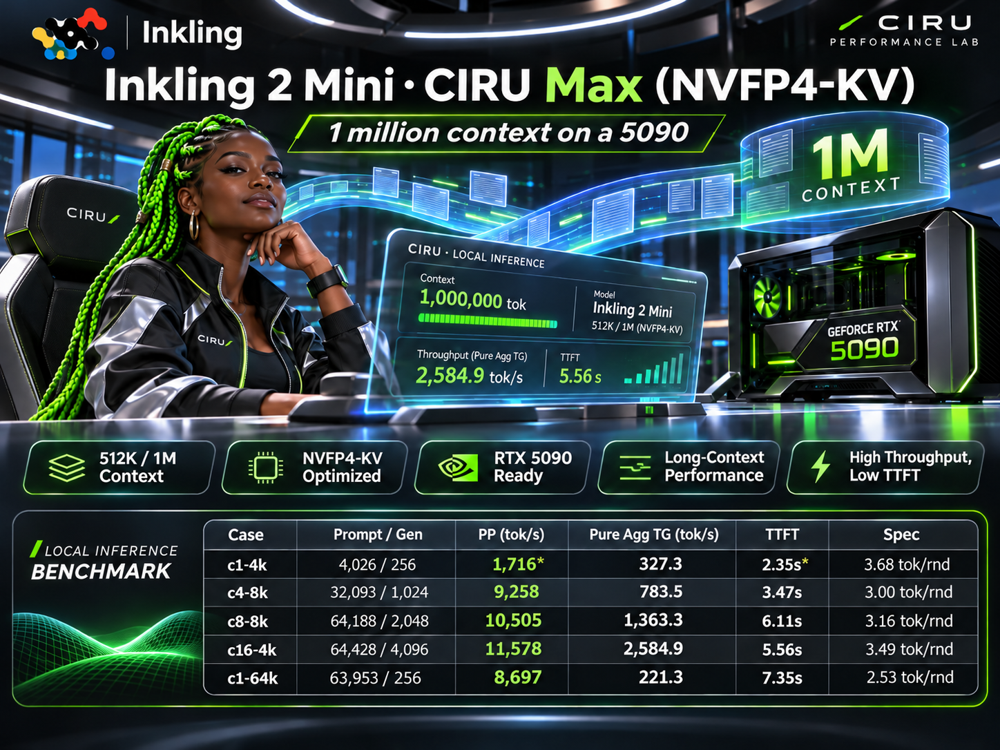

# Inkling 2 Mini CIRU 512K/1M (NVFP4-KV)

Serve Thinking Machines Lab's Inkling 2 Mini on a single **NVIDIA GeForce RTX 5090 with 32 GB VRAM**. The CIRU vLLM build offers **524,288 tokens with DSpark speculative decoding** or **1,048,576 tokens in target-only mode**. Both use an NVFP4 key-value cache with **43.75% less attention-cache storage than FP8**, including scales. The runtime uses Thinking Machines Lab's original mixed NVFP4/MXFP8 model weights and serves text through an OpenAI-compatible API.



*The 2,584.9 tokens/s and 5.56 s on the benchmark card were measured with 16 concurrent requests of roughly 4K prompt tokens each in 512K mode with DSpark. Use the separate 1M preset for the largest context window.*

## RTX 5090 performance

In 512K mode, a 32-request batch with roughly 3K input tokens per request delivered **1,393 end-to-end output tokens/s**, including prefill time. With 16 simultaneous requests, the build reached **11,578 input tokens/s** and an estimated **2,584.9 aggregate decode tokens/s**. In 1M mode, one 256K prompt generated at **126.6 tokens/s**. The 1M figure is the configured window, and the longest timed prompt shown below is 256K.

### 512K with DSpark

| Concurrent requests | Approx. prompt per request | Total input / output tokens | Input tok/s | Aggregate decode tok/s | Batch TTFT |
| ---: | ---: | ---: | ---: | ---: | ---: |
| 1 | 4K | 4,026 / 256 | 1,716* | 327.3 | 2.35 s* |
| 4 | 8K | 32,093 / 1,024 | 9,258 | 783.5 | 3.47 s |
| 8 | 8K | 64,188 / 2,048 | 10,505 | 1,363.3 | 6.11 s |
| 16 | 4K | 64,428 / 4,096 | **11,578** | **2,584.9** | **5.56 s** |
| 1 | 64K | 63,953 / 256 | 8,697 | 221.3 | 7.35 s |

### 1M with target-only decoding

| Concurrent requests | Approx. prompt per request | Input tok/s | Decode tok/s | TTFT |
| ---: | ---: | ---: | ---: | ---: |
| 1 | 64K | 8,074 | 161.3 | 7.92 s |
| 1 | 128K | 6,419 | 146.8 | 19.92 s |
| 1 | 256K | 4,427 | 126.6 | 57.75 s |

The tables use one RTX 5090, distinct text prompts, greedy decoding, and 256 output tokens per request. The separate 32-request run used temperature 1.0 and an output limit of 512 tokens per request. Batch TTFT measures the time from the first request starting until every request has streamed its first token. The aggregate decode estimate divides total output tokens after each stream’s first token by the time between the last first-token arrival and the end of the batch. End-to-end output throughput uses the entire batch duration. The asterisks mark cold prompt processing with Triton compilation. Each preset's context limit covers prompt and generation tokens together.

## Install on Linux

The benchmarked system used an RTX 5090 on x86-64 Linux with NVIDIA driver 620.70.06. The setup below uses Ubuntu 24.04 LTS and requires a CUDA 13-compatible NVIDIA driver with RTX 5090 support. Allow disk space for the approximately 20 GB checkpoint and the Docker image. Install Docker Engine and the NVIDIA Container Toolkit. Run `sudo nvidia-ctk runtime configure --runtime=docker` and `sudo systemctl restart docker` to enable GPU access. [Docker Engine for Ubuntu](https://docs.docker.com/engine/install/ubuntu/) · [NVIDIA Container Toolkit](https://docs.nvidia.com/datacenter/cloud-native/container-toolkit/latest/install-guide.html)

Clone the runtime and build its container. The GPU check should list the RTX 5090 from inside the container.

```bash
sudo apt-get update
sudo apt-get install -y git python3-venv
git clone https://github.com/ciru-ai/Inkling-2-Mini-CIRU-512K-1M-NVFP4-KV.git
cd Inkling-2-Mini-CIRU-512K-1M-NVFP4-KV
docker build -t inkling-2-mini-ciru .
docker run --rm --gpus all --entrypoint nvidia-smi inkling-2-mini-ciru
```

Download the original Thinking Machines checkpoint and its tested configuration from the Hugging Face release. Keep `mtp.safetensors` with the model so the 512K presets can use DSpark.

```bash
python3 -m venv .venv
.venv/bin/python -m pip install --upgrade huggingface_hub
.venv/bin/hf download jcbtc/Inkling-2-Mini-CIRU-512K-1M-NVFP4-KV \
  --include "*.json" --include "*.jinja" --include "*.safetensors" --include "tiktoken/*" \
  --local-dir ./weights
```

## Run

Choose one preset at a time on the 32 GB card. Run `bash serve.sh 512k ./weights` for speculative decoding or `bash serve.sh 1m ./weights` for the full context window.

| Preset | Per-request context limit | Decoding | Active sequences |
| --- | ---: | --- | ---: |
| `512k` | 524,288 | DSpark speculative | Up to 2 |
| `512k-throughput` | 524,288 | DSpark speculative | Up to 32 |
| `1m` | 1,048,576 | Target-only | 1 |
| `1m-throughput` | 1,048,576 | Target-only | Up to 32 |

The active sequence count is a scheduler limit. Concurrent requests share the GPU cache, so the total length admitted depends on how much context each sequence uses. The largest single prompts are best suited to the single-sequence `1m` preset.

```bash
bash serve.sh 512k ./weights
```

For a Docker setup using NVIDIA CDI, replace `--gpus all` in the GPU check with `--device nvidia.com/gpu=all` and launch with `INKLING_USE_CDI=1 bash serve.sh 512k ./weights`.

Once the server starts, test it from a second terminal. The local API base URL is `http://127.0.0.1:18753/v1` and the model ID is `main`.

```bash
curl --fail --silent --show-error http://127.0.0.1:18753/health
curl --fail --silent --show-error http://127.0.0.1:18753/v1/models
curl --fail --silent --show-error http://127.0.0.1:18753/v1/chat/completions \
  -H 'Content-Type: application/json' \
  -d '{"model":"main","messages":[{"role":"user","content":"What is 17 times 23?"}],"max_tokens":256,"temperature":0}'
```

## Files and credits

- CIRU publishes the NVIDIA runtime, launcher, and installation instructions on GitHub. The Hugging Face release also includes the model and draft weights. [GitHub](https://github.com/ciru-ai/Inkling-2-Mini-CIRU-512K-1M-NVFP4-KV) · [Hugging Face](https://huggingface.co/jcbtc/Inkling-2-Mini-CIRU-512K-1M-NVFP4-KV)
- Thinking Machines Lab developed Inkling 2 Mini and supplies the original checkpoint and DSpark draft weights. [Upstream model](https://huggingface.co/thinkingmachines/Inkling-2-Mini) · [Model Acceptable Use Policy](https://thinkingmachines.ai/model-acceptable-use-policy/)
- This build uses the vLLM project and its Inkling 2 Mini runtime. [vLLM](https://github.com/vllm-project/vllm) · [Apache License 2.0](https://www.apache.org/licenses/LICENSE-2.0)
